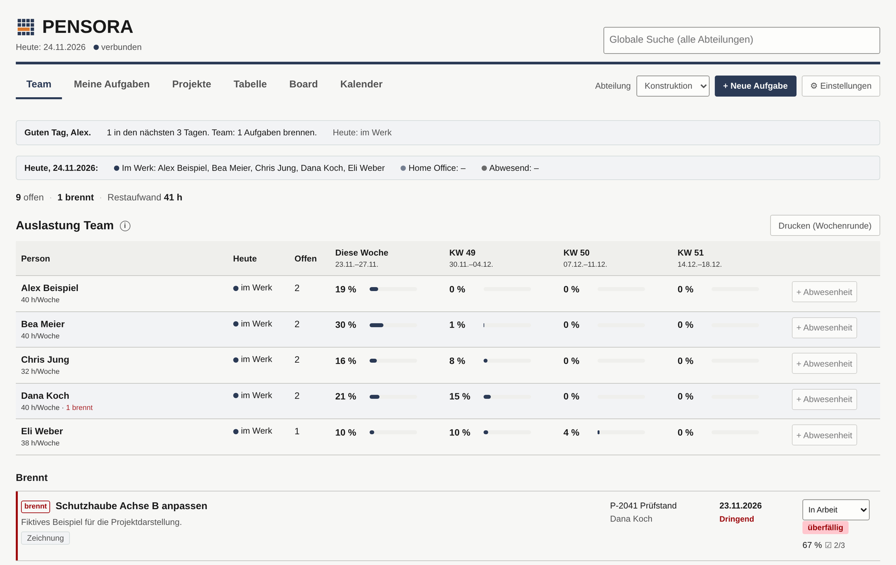
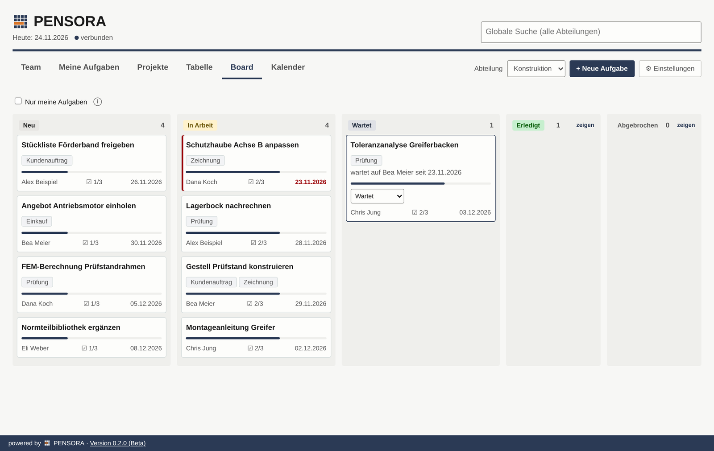
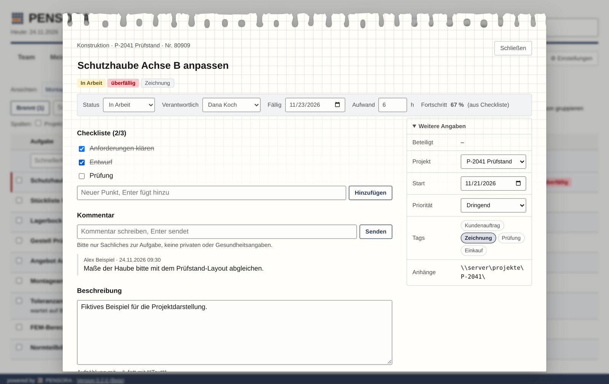
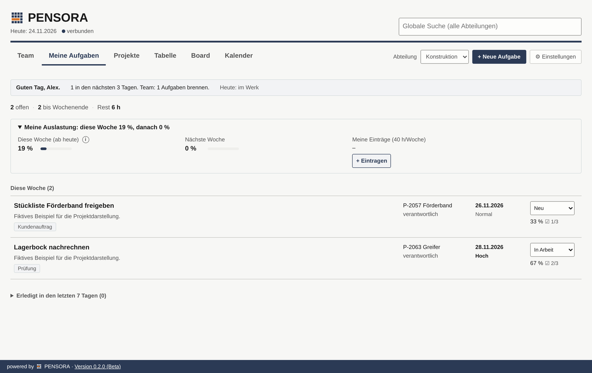
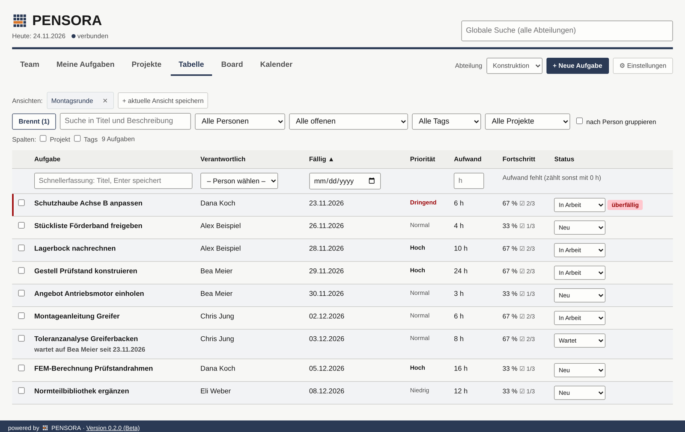
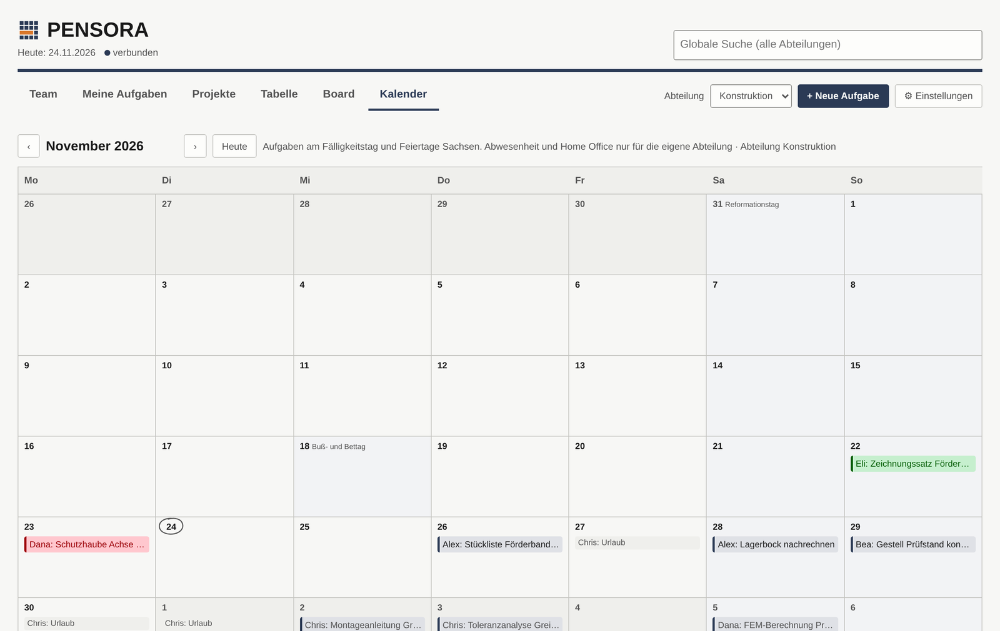
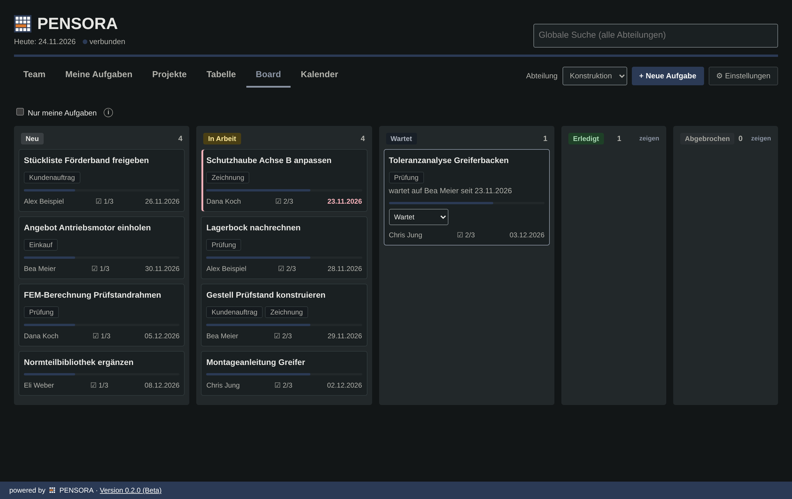

# PENSORA

**Open-source task and capacity planner for departments – local-first, no server, no cloud.**

> Status: in development. This repository reserves the name; the source code will be published here with version 1.0.

## What it is

PENSORA helps a department see who is working on what, by when, and how much capacity is left – a simpler, more readable alternative to typical cloud planners.

- Tasks with descriptions, owners, due dates, tags, checklists and comments
- Team view with capacity in percent, absences and home office
- Board, table and calendar views, personal task list
- Runs as a normal Windows program, **installs without admin rights**
- Data stays inside the company: instances sync via a shared network folder – no server, no cloud, no account
- Designed with GDPR in mind: minimal personal data, anonymisation of former staff, roles for staff, lead and admin
- Selectable branding (colours, logo) per company
- German and English user interface

## Screenshots

*Standard PENSORA layout, fictitious example data · Standard-Layout von PENSORA, erfundene Beispieldaten*

| | |
|---|---|
| **Team workload · Auslastung Team**  | **Board**  |
| **Task as a note sheet · Aufgabe als Notizblatt**  | **My tasks · Meine Aufgaben**  |
| **Table · Tabelle**  | **Calendar · Kalender**  |
| **Dark mode · Dunkler Modus**  | |

## Name

*PENSORA* is a made-up word: from Latin *pensum* (the work assigned for a day) and *hora* (hour) – work and time.

## Support

PENSORA is free and stays free. If it saves you time, you can buy me a coffee:

## License

Planned: GPL-3.0.

---

# PENSORA (Deutsch)

**Quelloffener Aufgaben- und Kapazitätsplaner für Abteilungen – lokal, ohne Server, ohne Cloud.**

> Stand: in Entwicklung. Dieses Repository sichert den Namen; der Quellcode wird hier mit Version 1.0 veröffentlicht.

## Worum es geht

PENSORA zeigt einer Abteilung, wer woran arbeitet, bis wann, und wie viel Kapazität noch frei ist – einfacher und lesbarer als übliche Cloud-Planer.

- Aufgaben mit Beschreibung, Verantwortlichen, Fälligkeit, Tags, Checklisten und Kommentaren
- Teamansicht mit Auslastung in Prozent, Abwesenheiten und Homeoffice
- Board, Tabelle, Kalender und eigene Aufgabenliste
- Normales Windows-Programm, **Installation ohne Adminrechte**
- Daten bleiben im Unternehmen: Abgleich über einen gemeinsamen Netzwerkordner – kein Server, keine Cloud, kein Konto
- Datenschutz von Anfang an mitgedacht: möglichst wenige Personendaten, Anonymisierung ausgeschiedener Personen, Rollen Mitarbeiter, Leitung und Admin
- Firmen-Design (Farben, Logo) wählbar
- Oberfläche auf Deutsch und Englisch

## Name

*PENSORA* ist ein Kunstwort aus lateinisch *pensum* (das zugeteilte Tagewerk) und *hora* (Stunde) – Arbeit und Zeit.

## Unterstützen

PENSORA ist kostenlos und bleibt es auch. Wenn es dir Zeit spart, freue ich mich über einen Kaffee:

## Lizenz

Geplant: GPL-3.0.
